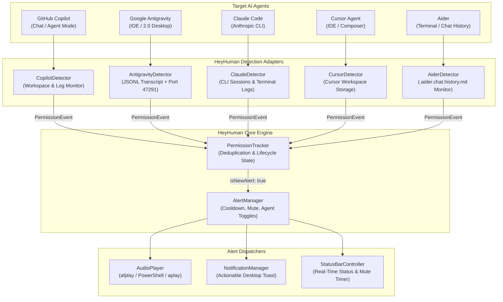

# HeyHuman 🚨

<div align="center">

<h3>Your AI is waiting. Permission required.</h3>

<p>
  A lightweight, reliable VS Code extension that sounds an audible alert whenever an AI coding agent requires your permission, approval, or input to continue working.
</p>

[](https://marketplace.visualstudio.com/)
[](https://www.typescriptlang.org/)
[](https://opensource.org/licenses/MIT)
[]()

</div>

---

## 💡 The Problem

Autonomous AI coding agents (such as GitHub Copilot in Agent Mode and Google Antigravity) are great at executing multi-step development tasks. But when an agent needs permission to run a terminal command, execute a restricted tool, or asks a clarifying question, **it stops and waits for you**.

If you've switched to another monitor, opened your browser, or stepped away to make coffee, the AI sits idle — and your time is wasted.

## ⚡ The Solution

**HeyHuman** keeps watch in the background. The instant an AI agent reaches a permission prompt, HeyHuman sounds a clear, audible siren (and optional desktop notification) so you can return, approve the step, and keep the agent flowing.

- 🔊 **Audible in Background**: Plays directly through native OS audio drivers (`afplay` on macOS, PowerShell `SoundPlayer` on Windows, `aplay`/`paplay` on Linux) so you never miss a prompt when VS Code is minimized.
- 🛡️ **Notification-Only**: HeyHuman **never** approves, denies, or runs commands automatically. You retain full control over your security boundary.
- 🔁 **Lifecycle Deduplication**: Plays exactly once per new permission request. It never rings incessantly in an annoying loop while a prompt is pending.
- 🔒 **100% Local & Private**: Zero telemetry, zero external network traffic. All inspection happens locally on your machine.

---

## 🏗️ Architecture



---

## 🤖 Supported Agents

| Agent | Surface | Detection Strategy | Detected Permission Types |
| :--- | :--- | :--- | :--- |
| **GitHub Copilot** | VS Code / Copilot Agent Mode | Log & Workspace Storage Observation (`workspaceStorage/<id>/GitHub.copilot-chat/`, `~/.copilot/logs`) | • Terminal execution approval prompts<br>• Custom tool confirmations (`prepareInvocation`)<br>• Script sandbox approval dialogs |
| **Google Antigravity** | Antigravity IDE & Antigravity 2.0 Desktop | Real-time JSONL Transcript Monitor (`~/.gemini/antigravity/brain/.../transcript.jsonl`) + Companion Port (`47291`) | • Sandbox bypass approvals (`BypassSandbox: true`)<br>• Clarification questionnaires (`ask_question`)<br>• Steps blocked on user input (`WAITING_FOR_INPUT`) |
| **Claude Code** | Anthropic `claude` CLI / Terminal Sessions | CLI Session & Project Logs Monitor (`~/.claude/sessions/`, `~/.claude/logs/`) | • Bash command confirmation prompts (`[Y/n]`)<br>• Tool execution approval requests<br>• File change confirmations |
| **Cursor Agent** | Cursor IDE & Composer | Cursor Workspace Storage Observation (`~/Library/Application Support/Cursor/...`) | • Terminal command approval gates<br>• Composer action confirmations<br>• File modification permissions |
| **Aider** | Aider Terminal & Workspace | Live Chat History Monitor (`.aider.chat.history.md`) | • Shell command execution approvals (`(Y)es/(N)o`)<br>• Code modification approvals |

---

## 🔊 Bundled Sound Profiles

HeyHuman includes 4 synthesized, license-free WAV audio assets:

- **`siren`** *(Default)*: A noticeable 2-second dual-tone oscillating emergency alert (880Hz – 1320Hz warble).
- **`alarm`**: Rapid 3-burst pulsed urgency tone (960Hz).
- **`chime`**: Harmonic ascending 3-note notification chime (C5 → E5 → G5).
- **`beep`**: Modern crisp double UI beep (1200Hz).
- **Custom Sound**: Point `heyhuman.sound.customSoundPath` to any local `.wav`, `.mp3`, or `.aiff` file.

---

## ⚙️ Configuration Reference

Configure these settings via VS Code Settings (`Cmd+,` / `Ctrl+,`) or in your `settings.json`:

```jsonc
{
  // Master toggle for all HeyHuman alerts
  "heyhuman.enabled": true,

  // Agent-specific controls
  "heyhuman.agents.copilot.enabled": true,
  "heyhuman.agents.antigravity.enabled": true,

  // Audio settings
  "heyhuman.sound.enabled": true,
  "heyhuman.sound.type": "siren", // "siren" | "alarm" | "chime" | "beep"
  "heyhuman.sound.volume": 80,    // 0 to 100
  "heyhuman.sound.customSoundPath": "",

  // Desktop notifications
  "heyhuman.notifications.enabled": true,
  "heyhuman.notifications.focusWindowOnClick": true,

  // Alert rate limiting & mute
  "heyhuman.alerts.cooldownSeconds": 5,
  "heyhuman.alerts.temporaryMuteDurationMinutes": 15,

  // Advanced paths & companion port
  "heyhuman.antigravity.companionPort": 47291,
  "heyhuman.antigravity.customLogPath": "",
  "heyhuman.copilot.customLogPath": ""
}
```

---

## 🎮 Commands & Status Bar

Open the Command Palette (`Cmd+Shift+P` / `Ctrl+Shift+P`):

- `HeyHuman: Toggle Alerts` — Quick toggle On/Off
- `HeyHuman: Test Sound` — Play the current sound and volume immediately
- `HeyHuman: Mute Temporarily` — Mute alerts for 15m, 30m, 1h, or 2h
- `HeyHuman: Unmute` — Instantly restore alerts
- `HeyHuman: Show Detection Status` — View active detectors and connection states
- `HeyHuman: Open Settings` — Open the settings editor

### Status Bar Item
The status bar displays real-time state:
- `$(bell) HeyHuman: On` — Active and monitoring
- `$(bell-slash) HeyHuman: Muted (12m)` — Temporarily muted with live countdown
- `$(mute) HeyHuman: Off` — Disabled

Click the status bar item at any time to open the **Quick Menu**.

---

## 🚀 Roadmap: What Next?

Here are the upcoming enhancements planned for the HeyHuman project:

### 1. Extended Agent Support (✅ Delivered in v1.1.0)
- [x] **Claude Code (Anthropic CLI)**: Real-time detection for `claude` CLI terminal sessions and approval prompts (`[Y/n]`).
- [x] **Cursor Agent & Windsurf**: Adapters for Cursor workspace storage and Composer confirmation gates.
- [x] **Aider**: Live chat history monitor for `.aider.chat.history.md` shell execution and file edit approvals.

### 2. Multi-Device & Mobile Push Notifications (Active Priority)
- [ ] **Pushover / ntfy.sh Integration**: Send push notifications directly to your phone or Apple Watch when an agent is waiting, so you can step away from your desk entirely.
- [ ] **Discord / Slack Webhooks**: Notify your private channel or direct message when long-running agent tasks hit a permission gate.

### 3. Voice & Speech Synthesis Alerts
- [ ] **Spoken Action Prompts**: Instead of just a siren, optionally speak the action: *"Hey Human! Copilot is waiting to run `npm test`"*.
- [ ] **Custom Voice Clips**: Support recorded voice cues.

### 4. Remote Approval Companion (Optional Webhook Action)
- [ ] **Mobile Approval Bridge**: A lightweight companion web interface allowing one-click approve/deny directly from your smartphone while away from your desk.

### 5. Operating System Tray Companion
- [ ] **Standalone System Tray App**: A lightweight background menu bar / tray app (macOS / Windows / Linux) that monitors all coding agents system-wide without requiring VS Code to remain open.

---

## 🛠️ Development & Testing

### Prerequisites
- Node.js 18+ (tested up to Node.js 24)
- npm 9+

### Build & Run Tests
```bash
# Clone the repository
git clone https://github.com/heyhuman/heyhuman.git
cd HeyHuman

# Install dependencies
npm install

# Compile TypeScript
npm run compile

# Run the 24 automated unit tests
npm test
```

### Package as VSIX
```bash
npm run package
# Generates heyhuman-1.0.0.vsix
```

### Install in VS Code
```bash
code --install-extension heyhuman-1.0.0.vsix
```

---

## 🔒 Security & Privacy

- **Safe By Design**: HeyHuman is strictly a notification utility. It has zero capability to approve or bypass permission prompts on your behalf.
- **Local Sound Generation**: Built-in sound files are synthesized locally without any network requests.
- **No Telemetry**: No usage stats, file contents, command strings, or private data are ever transmitted to any remote server.

---

## 📄 License

[MIT](LICENSE) © 2026 HeyHuman
