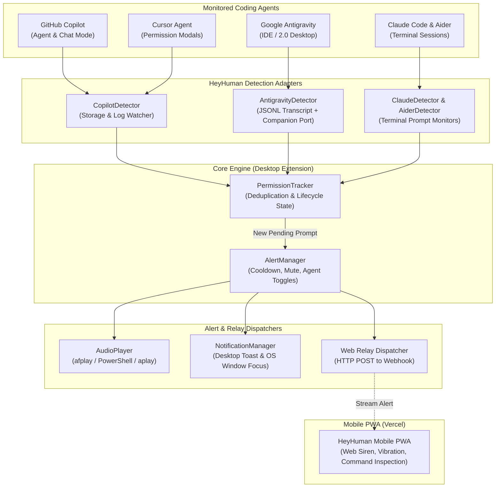

# HeyHuman 🚨🤖

<p align="center">
  
</p>

<p align="center">
  <strong>"Hey human, wake up! Your AI agent is waiting for your permission."</strong><br>
  Audible siren, voice speech, and mobile alerts when autonomous AI agents (Google Antigravity, GitHub Copilot, Claude Code, Cursor, Aider) need your permission.
</p>

<p align="center">
  <a href="https://marketplace.visualstudio.com/items?itemName=akdey.heyhuman"></a>
  <a href="https://open-vsx.org/extension/akdey/heyhuman"></a>
  <a href="https://github.com/akdey/HeyHuman/releases/tag/v1.2.1"></a>
  
</p>

---

## ⚡ The Problem & The Solution

When autonomous AI coding agents like **Google Antigravity**, **GitHub Copilot**, **Claude Code**, **Cursor**, or **Aider** encounter a sensitive operation (running bash commands, bypassing sandboxes, editing files, or asking clarification questions), execution **blocks** until you provide approval.

If you switch to another monitor, open your browser, or step away to make coffee, the AI sits idle — and your time is wasted.

**HeyHuman** monitors your agents continuously in the background. The instant an agent reaches an approval gate or question, HeyHuman plays an emergency audio siren, speaks aloud, and relays real-time alerts to your smartphone so you never stall your workflow.

---

## 🏗️ Architecture



---

## 🤖 Supported Agents

| Agent | Surface | Detection Strategy | Detected Permission Types |
| :--- | :--- | :--- | :--- |
| **Google Antigravity** | Antigravity IDE & 2.0 Desktop | Real-time JSONL Transcript Monitor (`~/.gemini/antigravity/brain/.../transcript.jsonl`) + Companion Port (`47291`) | • Sandbox bypass prompts (`BypassSandbox: true`)<br>• Interactive questions (`ask_question`)<br>• Steps blocked on user input (`WAITING_FOR_INPUT`) |
| **GitHub Copilot** | VS Code / Copilot Agent Mode | Log & Workspace Storage Observation (`workspaceStorage/<id>/GitHub.copilot-chat/`, `~/.copilot/logs`) | • Terminal execution approval prompts<br>• Tool confirmations (`prepareInvocation`)<br>• Script sandbox approval dialogs |
| **Claude Code** | Terminal CLI (`claude`) | Terminal output regex & ANSI stream watcher | • Bash command confirmation prompts (`[y/n]`)<br>• File modification authorizations |
| **Cursor Agent** | Cursor IDE | Composer log & terminal state watcher | • Shell execution approvals<br>• Workspace edits requiring confirmation |
| **Aider** | Terminal CLI (`aider`) | Terminal stream & git lock watcher | • Shell command execution prompts<br>• Auto-commit confirmations |

---

## 🔊 Bundled Sound Profiles

HeyHuman includes 4 synthesized, license-free WAV audio assets played via native OS audio drivers (`afplay` on macOS, PowerShell `SoundPlayer` on Windows, `aplay`/`paplay` on Linux):

- **`siren`** *(Default)*: Rapid 2-second dual-tone oscillating emergency alert (880Hz – 1320Hz warble).
- **`alarm`**: Rapid 3-burst pulsed urgency tone (960Hz).
- **`chime`**: Harmonic ascending 3-note notification chime (C5 → E5 → G5).
- **`beep`**: Modern crisp double UI beep (1200Hz).
- **Custom Sound**: Point `heyhuman.sound.customSoundPath` to any local `.wav`, `.mp3`, or `.aiff` file.

---

## 🌐 HeyHuman Mobile Web App (PWA)

For developers away from their desk, cooking, or in another room where desktop sirens can't be heard:

<p align="center">
  
</p>

### Key Highlights
- **PWA Installable**: Add to Home Screen on iOS Safari and Android Chrome with native offline icon.
- **Live Command Inspection**: View the exact command, agent, or tool requiring approval directly on your screen.
- **QR Code Pairing**: Instant scan with your phone camera, with robot logo centered in the QR code.
- **Rotate Key Support**: 1-click button to cycle fresh secure room IDs (`hyper-orbit-318`).
- **Acoustic Fallback**: Synthesized Web Audio oscillator engine that works reliably across mobile browsers.
- **Haptic Vibration**: Physical mobile vibration pattern on incoming alert bursts.

### 📱 How to Use on Your Phone (Install PWA or Browser)

You do **not** need to install any app from the App Store or Play Store:

1. **Open on your phone**:
   - Open your deployed URL (e.g., `https://hey-human-akdey.vercel.app`) or scan the **QR code** on your desktop screen.
2. **Install as a PWA (Home Screen App)**:
   - **iPhone (Safari)**: Tap the **Share** button (box with up arrow) &rarr; scroll down &rarr; tap **"Add to Home Screen"**.
   - **Android (Chrome)**: Tap the **Three Dots (⋮)** &rarr; tap **"Install App"** (or "Add to Home screen").
   - It now behaves like a native app on your phone with the HeyHuman robot icon!
3. **Enable sound on your phone**:
   - Tap **"Tap for Sound"** / **"Sound On"** once so the mobile browser allows background audio sirens and speech synthesis.

---

### 🔗 How to Connect Your Extension to Your Phone (30-Second Setup)

Once your web app is open on your phone:

1. **Copy your Room ID**:
   - In the web app, notice your room name (e.g., `orbit-swift-551`) or tap the **🔄 Rotate** button to generate a fresh one, then tap **Copy**.
2. **Set the key in your IDE**:
   - In **VS Code** or **Google Antigravity**, press **`Cmd+Shift+P`** (or `Ctrl+Shift+P` on Windows/Linux).
   - Search for: **`HeyHuman: Set Web Room ID`**.
   - Paste your Room ID and hit **Enter**.
   - *(Alternative)*: Click the HeyHuman status bar item at the bottom right &rarr; select **`📡 Pair Web Alert Room...`**.
3. **Walk away from your desk**:
   - Whenever an agent asks for permission or questions, your phone will loudly siren and vibrate!

---

## ⚙️ Configuration Reference

Configure these settings via VS Code Settings (`Cmd+,` / `Ctrl+,`) or in your `settings.json`:

```jsonc
{
  // Master toggle for all HeyHuman alerts
  "heyhuman.enabled": true,

  // Web Relay & Remote Room
  "heyhuman.webEndpoint": "https://hey-human-akdey.vercel.app",
  "heyhuman.webRoom": "your-room-id",

  // Agent-specific controls
  "heyhuman.agents.antigravity.enabled": true,
  "heyhuman.agents.copilot.enabled": true,
  "heyhuman.agents.claude.enabled": true,
  "heyhuman.agents.cursor.enabled": true,
  "heyhuman.agents.aider.enabled": true,

  // Audio settings
  "heyhuman.sound.enabled": true,
  "heyhuman.sound.type": "siren", // "siren" | "alarm" | "chime" | "beep"
  "heyhuman.sound.volume": 80,    // 0 to 100
  "heyhuman.sound.customSoundPath": "",

  // Desktop notifications & Window Focus
  "heyhuman.notifications.enabled": true,
  "heyhuman.notifications.focusWindowOnClick": true,

  // Alert rate limiting & mute
  "heyhuman.alerts.cooldownSeconds": 5,
  "heyhuman.alerts.temporaryMuteDurationMinutes": 15
}
```

---

## ⚠️ Known Limitations & Upcoming Features (WIP)

### 🧪 Remote Approval from Web / Mobile (Work In Progress)

- **Terminal CLI Prompts (Claude Code, Aider, CLI)**:
  - Tapping **`Approve (y)`** or **`Reject (n)`** queues an action to your desktop extension, which injects `y` or `n` into the active terminal session.
- **GUI Dialogs & Agent Questions (Antigravity & Copilot)**:
  - **The Sandbox Limitation**: In Google Antigravity and VS Code Copilot, permission confirmations (such as "Allow Sandbox Bypass" or `ask_question` option forms) run inside sandboxed IDE webviews and native Electron dialogs. VS Code's extension security model strictly isolates third-party extensions from programmatically clicking native dialog buttons or answering webview form inputs.
  - **Current Behavior**: When you tap **`Approve`** or **`🪟 Bring IDE to Front`** on your phone, HeyHuman uses OS-level window activation (AppleScript on macOS, PowerShell on Windows) to automatically bring the IDE to the front on your desk, positioning you to click or select the option immediately.
  - **What is being developed (WIP)**: We are working on a bidirectional companion daemon that parses multi-choice questionnaire options from transcripts and streams interactive radio/checkbox buttons directly to your phone screen so you can answer complex questions remotely.

---

## 🚀 Future Roadmap

### 1. Interactive Remote Question Answering
- [ ] **Mobile Questionnaire Bridge**: Render Antigravity `ask_question` option choices directly on mobile, allowing you to select options (A, B, C) or type clarification replies from your phone.
- [ ] **Companion Daemon Injection**: Deep OS/IPC hook to auto-dismiss native sandbox bypass confirmations on verified mobile approval.

### 2. Multi-Device & Native Push Notifications
- [ ] **Web Push API (Apple APNs & FCM)**: Receive persistent lock-screen push notifications even when the Safari / Chrome browser tab is closed.
- [ ] **Apple Watch & Wear OS Complications**: Haptic pulse and prompt inspection directly on smartwatches.
- [ ] **Discord & Slack Webhooks**: Relay alerts to private developer team channels when long-running agent workflows hit gates.

### 3. Voice & Speech Synthesis Intelligence
- [ ] **Spoken Action Prompts**: Custom spoken descriptions: *"Hey human! Antigravity needs permission to run git push"*.
- [ ] **Custom Voice Packs**: Choose between different voices (Jarvis, Retro Sci-Fi, Minimalist).

### 4. Standalone System Tray Companion
- [ ] **Menu Bar / System Tray App**: Lightweight background tray app for macOS, Windows, and Linux that monitors agents across all workspaces without requiring VS Code to remain open.

---

## 🛠️ Development & Testing

```bash
# Clone the repository
git clone https://github.com/akdey/HeyHuman.git
cd HeyHuman

# Extension unit tests (30 passing tests)
cd extension
npm install
npm test

# Build mobile PWA
cd ../web
npm install
npm run build
```

---

## 👨‍💻 Author & Engineering

Designed & Engineered by **[AMIT KUMAR DEY](https://portfolio.akdey.vercel.app/)**

License: MIT
