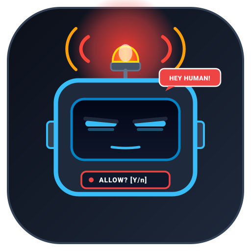
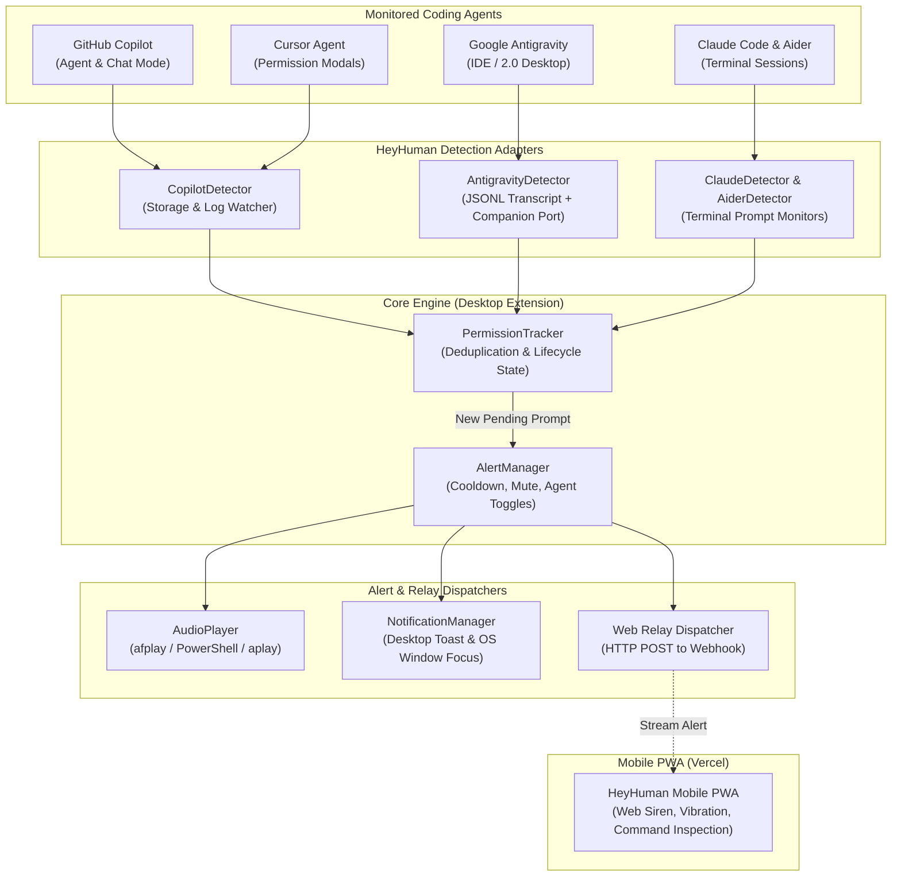

# HeyHuman 🚨🤖

<p align="center">
  
</p>

<p align="center">
  <strong>"Hey human, wake up! Your AI agent is waiting for your permission."</strong><br>
  Audible sirens, voice speech, and phone alerts when autonomous AI agents (Google Antigravity, GitHub Copilot, Claude Code, Cursor, Aider) need your approval.
</p>

<p align="center">
  <a href="https://marketplace.visualstudio.com/items?itemName=akdey.heyhuman"></a>
  <a href="https://open-vsx.org/extension/akdey/heyhuman"></a>
  <a href="https://github.com/akdey/HeyHuman/releases/tag/v1.2.1"></a>
  
</p>

---

## 🤔 Why Does This Exist?

When you work with autonomous coding agents (**Google Antigravity**, **GitHub Copilot**, **Claude Code**, **Cursor**, or **Aider**), they periodically pause to ask:
- *"Can I run this terminal command?"*
- *"Can I edit this file outside the sandbox?"*
- *"I have a question about your project requirements..."*

If you switch to another monitor, open a browser tab, or step away to grab a coffee, **your AI stops completely and waits idle** — wasting precious coding time.

**HeyHuman** solves this:
1. **Loud Audio Sirens**: Plays unmistakable native sirens (`afplay` / PowerShell / `aplay`) that you can hear from another room, even when your editor is minimized.
2. **Instant Phone Relay**: Rings and vibrates your smartphone with the exact command or question waiting for you.
3. **One-Tap Bring to Front**: Pop your IDE back to the foreground on your desktop right from your phone.

---

## 📱 30-Second Setup Guide

You can connect your phone to your desktop in less than a minute — **zero mobile app downloads required**.

### Step 1: Open on Your Phone (Install as PWA)

1. Open **[hey-human-akdey.vercel.app](https://hey-human-akdey.vercel.app)** on your mobile browser (or scan the QR code from your desktop web app).
2. **Install to Home Screen** (optional, recommended):
   - **iPhone (Safari)**: Tap the **Share** button (square with arrow) &rarr; scroll down &rarr; tap **"Add to Home Screen"**.
   - **Android (Chrome)**: Tap the **Three Dots (⋮)** &rarr; tap **"Install App"** (or "Add to Home screen").
3. **Enable Audio & Lock Screen Alerts**:
   - Tap **"Tap for Sound"** once so your phone allows emergency sirens.
   - Tap **"Lock Alert"** (or approve the notification prompt) so HeyHuman registers cryptographic **Web Push** — this delivers native banners and vibration even when your phone is **locked and asleep in your pocket, with virtually zero battery drain**!
   - *(Optional)*: Tap **"Stay On"** if you want your phone propped up on your desk without dimming.

---

### Step 2: Connect to Your Desktop Editor

1. On your phone screen, copy your **Room ID** (e.g., `orbit-swift-551`), or tap **🔄** to generate a fresh one.
2. In **VS Code** or **Google Antigravity**:
   - Press **`Cmd+Shift+P`** (or `Ctrl+Shift+P` on Windows/Linux).
   - Type and choose: **`HeyHuman: Set Web Room ID`**.
   - Paste your Room ID and hit **Enter**.
   - *(Alternative)*: Click the **HeyHuman** item in your status bar (bottom right) &rarr; choose **`📡 Pair Web Alert Room...`**.
3. **You're Done!** Walk away from your desk. The moment your AI agent hits a permission checkpoint, your phone will alert you immediately.

---

## ⚡ Daily Workflow & Controls

When an agent needs your permission:
- **Desktop**: Sounds a loud emergency siren, presents a desktop notification, and speaks the prompt aloud.
- **Mobile Screen**: Vibrates and displays the exact command or question in a terminal inspection card, with 4 instant actions:
  - **`Approve (y)`**: Dispatches `'y'` into the active terminal for CLI agents.
  - **`Reject (n)`**: Dispatches `'n'` into the active terminal to decline.
  - **`🪟 Bring IDE to Front`**: Automatically raises your editor window over all other apps on your Mac/PC so you can view it immediately.
  - **`Silence Only`**: Mutes the alarm sound without altering agent state.

---

## ⚠️ Known Limitations & Upcoming Features (WIP)

### 🧪 Remote Approvals: Terminal vs. GUI Webview Dialogs

- **Terminal-Based Agents (Claude Code, Aider, CLI)**:
  - Tapping **`Approve (y)`** or **`Reject (n)`** injects `'y'` or `'n'` directly into the active terminal session.
- **GUI Dialogs & Agent Chat Modals (Google Antigravity & Copilot)**:
  - **Security Boundary**: In Google Antigravity and VS Code Copilot, permission modals (like "Run unsandboxed command" or interactive questionnaires `ask_question`) run inside sandboxed Electron webviews and native IDE modal dialogs. VS Code's security architecture strictly prohibits third-party extensions from programmatically clicking native dialog buttons.
  - **Current Behavior**: When you tap **`Approve`** or **`🪟 Bring IDE to Front`**, HeyHuman uses OS-level window activation (AppleScript on macOS, PowerShell on Windows) to immediately bring your IDE to the foreground on your desktop monitor so you can make your selection.
  - **What's Coming (WIP)**: We are developing a companion bridge that parses question options directly from agent transcripts and renders interactive radio/checkbox options on your phone for full remote answering.

---

## ⚙️ Configuration Reference

Customize your experience in VS Code Settings (`Cmd+,` / `Ctrl+,`) or in `settings.json`:

```jsonc
{
  // Master toggle for all HeyHuman alerts
  "heyhuman.enabled": true,

  // Web Relay & Remote Room
  "heyhuman.webEndpoint": "https://hey-human-akdey.vercel.app",
  "heyhuman.webRoom": "your-room-id",

  // Agent-specific controls
  "heyhuman.agents.antigravity.enabled": true,
  "heyhuman.agents.copilot.enabled": true,
  "heyhuman.agents.claude.enabled": true,
  "heyhuman.agents.cursor.enabled": true,
  "heyhuman.agents.aider.enabled": true,

  // Audio settings
  "heyhuman.sound.enabled": true,
  "heyhuman.sound.type": "siren", // "siren" | "alarm" | "chime" | "beep"
  "heyhuman.sound.volume": 80,    // 0 to 100
  "heyhuman.sound.customSoundPath": "",

  // Desktop notifications & Window Focus
  "heyhuman.notifications.enabled": true,
  "heyhuman.notifications.focusWindowOnClick": true,

  // Alert rate limiting & mute
  "heyhuman.alerts.cooldownSeconds": 5,
  "heyhuman.alerts.temporaryMuteDurationMinutes": 15
}
```

---

## 🤖 Supported Agents

HeyHuman actively monitors:

| Agent | Surface | Detection Strategy | Detected Permission Types |
| :--- | :--- | :--- | :--- |
| **Google Antigravity** | Antigravity IDE & 2.0 Desktop | Real-time JSONL Transcript Monitor (`~/.gemini/antigravity/brain/.../transcript.jsonl`) + Companion Port (`47291`) | • Sandbox bypass prompts (`BypassSandbox: true`)<br>• Interactive questions (`ask_question`)<br>• Steps blocked on user input (`WAITING_FOR_INPUT`) |
| **GitHub Copilot** | VS Code / Copilot Agent Mode | Log & Workspace Storage Observation (`workspaceStorage/<id>/GitHub.copilot-chat/`, `~/.copilot/logs`) | • Terminal execution approval prompts<br>• Tool confirmations (`prepareInvocation`)<br>• Script sandbox approval dialogs |
| **Claude Code** | Terminal CLI (`claude`) | Terminal output regex & ANSI stream watcher | • Bash command confirmation prompts (`[y/n]`)<br>• File modification authorizations |
| **Cursor Agent** | Cursor IDE | Composer log & terminal state watcher | • Shell execution approvals<br>• Workspace edits requiring confirmation |
| **Aider** | Terminal CLI (`aider`) | Terminal stream & git lock watcher | • Shell command execution prompts<br>• Auto-commit confirmations |

---

## 🏗️ Architecture



---

## 🚀 Future Roadmap

### 1. Interactive Remote Question Answering
- [ ] **Mobile Questionnaire Bridge**: Render Antigravity `ask_question` option choices directly on mobile, allowing you to select options (A, B, C) or type clarification replies from your phone.
- [ ] **Companion Daemon Injection**: Deep OS/IPC hook to auto-dismiss native sandbox bypass confirmations on verified mobile approval.

### 2. Multi-Device & Native Push Notifications
- [ ] **Web Push API (Apple APNs & FCM)**: Receive persistent lock-screen push notifications even when the browser tab is closed.
- [ ] **Apple Watch & Wear OS Complications**: Haptic pulse and prompt inspection directly on smartwatches.
- [ ] **Discord & Slack Webhooks**: Relay alerts to private developer team channels when long-running agent workflows hit gates.

### 3. Voice & Speech Synthesis Intelligence
- [ ] **Spoken Action Prompts**: Custom spoken descriptions: *"Hey human! Antigravity needs permission to run git push"*.
- [ ] **Custom Voice Packs**: Choose between different voices (Jarvis, Retro Sci-Fi, Minimalist).

### 4. Standalone System Tray Companion
- [ ] **Menu Bar / System Tray App**: Lightweight background tray app for macOS, Windows, and Linux that monitors agents across all workspaces without requiring VS Code to remain open.

---

## 🛠️ Development & Testing

```bash
# Clone the repository
git clone https://github.com/akdey/HeyHuman.git
cd HeyHuman

# Extension unit tests (30 passing tests)
cd extension
npm install
npm test

# Build mobile PWA
cd ../web
npm install
npm run build
```

---

## 👨‍💻 Author & Engineering

Designed & Engineered by **[AMIT KUMAR DEY](https://portfolio.akdey.vercel.app/)**

License: MIT
