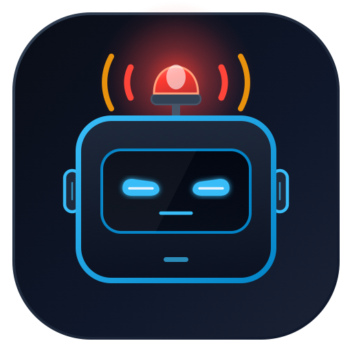

# HeyHuman 🚨🤖

<p align="center">
  
</p>

<p align="center">
  <strong>"Hey human, wake up! Your AI agent is waiting for your permission."</strong><br>
  Audible siren, voice speech, and phone alerts when autonomous AI agents (Google Antigravity, GitHub Copilot, Claude Code, Cursor, Aider) need your permission.
</p>

<p align="center">
  <a href="https://marketplace.visualstudio.com/items?itemName=akdey.heyhuman"></a>
  <a href="https://open-vsx.org/extension/akdey/heyhuman"></a>
  <a href="https://github.com/akdey/HeyHuman/releases/tag/v1.2.0"></a>
  
</p>

---

## ⚡ Features Matrix

| Feature | Description | Status |
| :--- | :--- | :---: |
| 🚨 **Loud Audio Sirens** | Emergency police siren, alarm, chime, and beep audio profiles | ✅ Done |
| 🤖 **Multi-Agent Watchers** | Supports Google Antigravity, GitHub Copilot, Claude Code, Cursor, and Aider | ✅ Done |
| 🪟 **Contextual Window Focus** | Automatically focuses editor, terminal panel, or chat on approval prompts | ✅ Done |
| 🌐 **PWA & Mobile Relay App** | Web app for phones/tablets away from desk; zero local installation needed | ✅ Done |
| 📱 **QR Code Mobile Pairing** | Instant phone camera scan to tune phone to your desktop's alert room | ✅ Done |
| 🔄 **Rotate Key & Auto-Tune** | Instantly generate/cycle secure room keys with automatic persistent tuning | ✅ Done |
| 🗣️ **Voice Speech Alerts** | Text-to-speech announcement: *"Hey human! AI needs your permission!"* | ✅ Done |
| 🔒 **Multi-User Room Isolation** | Unique isolated rooms (`?room=akdey`) so alerts never leak to others | ✅ Done |
| 🪝 **Direct Webhook API** | Simple HTTP POST integration for custom CLI tools and pipelines | ✅ Done |

---

## 📁 Repository Structure

```
HeyHuman/
├── extension/          # VS Code & Antigravity IDE Extension
│   ├── src/            # Multi-agent watchers, notification & sound engine
│   ├── media/          # Audio sirens, vector logos, and visual assets
│   ├── test/           # Test suite (30 passing unit tests)
│   └── package.json    # Published to VS Code Marketplace & Open VSX
│
└── web/                # Mobile-Responsive PWA & Web Siren (Vercel)
    ├── src/            # React + Vite + Web Audio & Speech Synthesis
    ├── api/            # Serverless Webhook & Polling Endpoint (/api/alert)
    ├── public/         # PWA Manifest, Service Worker assets, sound fallbacks
    └── vercel.json     # 1-Click Vercel deployment configuration
```

---

## 🌐 HeyHuman Web App (Deploy on Vercel)

For developers away from their desk, cooking, or on their phone where desktop sirens can't be heard:


### Key Highlights
- **PWA Installable**: Add to Home Screen on iOS Safari and Android Chrome.
- **QR Code Pairing**: Instant scan with your phone camera, with robot logo centered in the QR code.
- **Rotate Key Support**: 1-click button to cycle new secure room IDs (`hyper-orbit-318`).
- **Acoustic Fallback**: Synthesized Web Audio oscillator engine that works offline and across mobile browsers.
- **Haptic Feedback**: Mobile vibration sequence on incoming alerts.

### 📱 How to Use on Your Phone (Install PWA or Browser)

You do **not** need to install any app from the App Store or Play Store:

1. **Open on your phone**:
   - Open your deployed URL (e.g., `https://your-domain.vercel.app`) or scan the **QR code** on your desktop screen.
2. **Install as a PWA (Home Screen App)**:
   - **iPhone (Safari)**: Tap the **Share** button (box with up arrow) &rarr; scroll down &rarr; tap **"Add to Home Screen"**.
   - **Android (Chrome)**: Tap the **Three Dots (⋮)** &rarr; tap **"Install App"** (or "Add to Home screen").
   - It now behaves like a native app on your phone with the HeyHuman robot icon!
3. **Enable sound on your phone**:
   - Tap **"Tap for Sound"** / **"Sound On"** once so the browser allows background audio sirens and speech synthesis.

---

### 🔗 How to Connect Your Extension to Your Phone (30-Second Setup)

Once your web app is open on your phone:

1. **Copy your Room ID**:
   - In the web app, notice your room name (e.g., `akdey`) or tap the **🔄 Rotate** button to generate a fresh one, then tap **Copy**.
2. **Set the key in your IDE**:
   - In **VS Code** or **Google Antigravity**, press **`Cmd+Shift+P`** (or `Ctrl+Shift+P` on Windows/Linux).
   - Search for: **`HeyHuman: Set Web Room ID`**.
   - Paste your Room ID (e.g. `akdey`) and hit **Enter**.
   - *(Alternative)*: Click the HeyHuman status bar item at the bottom right &rarr; select **`📡 Pair Web Alert Room...`**.
3. **Walk away from your desk**:
   - Whenever Antigravity, GitHub Copilot, Claude Code, Cursor, or Aider asks for permission, your phone will loudly siren and vibrate!

---

## 🧩 Editor Extension (Antigravity, VS Code, Cursor)

Install directly from your editor's Extension marketplace:
- **VS Code**: Search `HeyHuman` or visit [VS Code Marketplace](https://marketplace.visualstudio.com/items?itemName=akdey.heyhuman).
- **Antigravity / Cursor / VSCodium**: Search `HeyHuman` on [Open VSX](https://open-vsx.org/extension/akdey/heyhuman).

### Extension CLI commands
- `HeyHuman: Test Alert Sound`
- `HeyHuman: Temporarily Mute Alerts (15 mins)`
- `HeyHuman: Unmute Alerts`
- `HeyHuman: Toggle Enable/Disable`

---

## 👨‍💻 Author & Engineering

Designed & Engineered by **[AMIT KUMAR DEY](https://portfolio.akdey.vercel.app/)**

License: MIT
